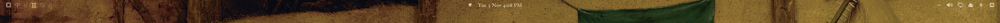
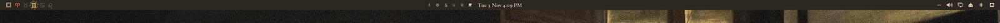
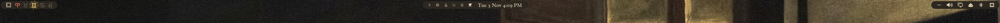
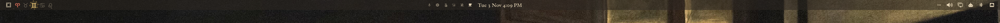

# Omarchy bar modes

Click effects for the [Omarchy](https://omarchy.org) bar. Click empty bar space to switch the bar between four looks. Each gesture undoes itself the second time, so you always end up back on transparent.

| Gesture on empty bar space | Mode |
|----------------------------|------|
| (default) | **Transparent**: widgets float straight on the wallpaper |
| Double left-click | **Opaque**: a solid bar in the theme's bar colour |
| Middle-click | **Pill**: each group of widgets sits on its own rounded pill |
| Right-click | **Translucent**: a tinted, see-through strip |






The mode you pick is saved to `~/.config/omarchy/shell.json` (`bar.mode`), so it survives restarts.

It also adds **theme bar fonts**. A theme can include a one-line `bar.font` file naming a font family, and the bar uses that font while the theme is applied. For example, [Renaissance](https://github.com/ScytheAkira/omarchy-renaissance-theme) uses this for its Rinascimento font. Themes without the file keep your normal bar font.

## Install

```sh
git clone https://github.com/ScytheAkira/omarchy-bar-modes.git
cd omarchy-bar-modes
./install.sh
```

The installer does the following:

1. Finds your clone of Omarchy's bar plugin in `~/.config/omarchy/plugins/`. If you don't have one, it creates it with `omarchy plugin clone omarchy.bar`.
2. Backs the clone up to `~/.config/omarchy/theme-backups/`.
3. Replaces the clone's `Bar.qml` with the one from this repo.
4. Restarts the shell.

It never touches `/usr/share/omarchy/`.

Tested on Omarchy 4.0.6. `Bar.qml` replaces Omarchy's whole bar engine, and a bar that fails to load leaves you with no bar. So on any other version the installer stops and asks you to compare the file with `/usr/share/omarchy/shell/plugins/bar/Bar.qml` first. Once you've checked it, run `./install.sh --force`.

## Uninstall

```sh
./install.sh --undo
```

This puts back the `Bar.qml` from the first backup the installer made. If there is no backup, it uses Omarchy's stock file. To drop the clone entirely and go back to the built-in bar, run `omarchy plugin remove <your-clone-id>`, or delete its folder and restart the shell.

## License

MIT. `Bar.qml` is a modified copy of the bar from [Omarchy](https://github.com/basecamp/omarchy), which is MIT licensed.
